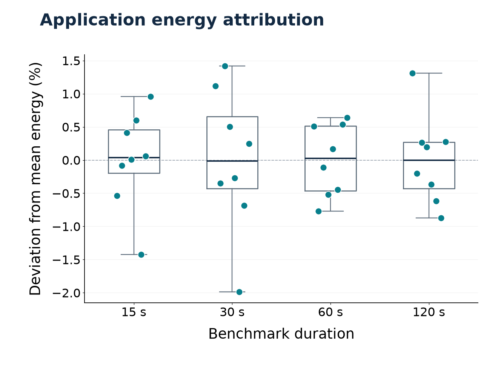

# How long is long enough? Energy benchmarking for CI/CD

Research code, measured data and print-ready figures for our **20 November 2026 poster session**. We study how benchmark duration affects energy measurement variability and the cost of future energy regression testing (ERT).

**Preliminary finding:** longer benchmarks consumed approximately proportionally more energy, but did not consistently reduce relative variability. These are baseline measurements; regression detection reliability has not yet been validated.

## Start here

- [Results in brief](RESULTS_BRIEF.md) · [Full methods and report](REPORT.md)
- [Poster text, research questions and references](docs/POSTER.md)
- [Metrics table and definitions](docs/METRICS.md)
- [Print-ready graphs and planned BPMN pipeline](outputs/poster-assets/README.md)
- [Run-level data](results/runs.csv) · [Duration summary](results/duration_summary.csv)
- [Deployment and Grafana dashboard](infrastructure/README.md)



Each dot is one complete run, expressed as percentage deviation from the mean of the eight runs **at the same duration**. The box line is the median; the dashed zero line is the mean. Kepler's application attribution is an estimate.

## Experiment and preliminary results

Google Online Boutique ran on a single bare-metal MicroK8s node (Intel Core i7-6700, four physical cores/eight logical CPUs). Locust simulated browsing, adding products to carts and mock checkout. The generator shared the measured host.

- Four measured durations: **15, 30, 60 and 120 seconds**, eight repetitions each.
- Three concurrent users, no think time, fixed per-user seed; duration order randomized within eight complete blocks.
- Each run: 15-second loaded warm-up, measured window, then an excluded 11-second loaded guard to bracket the cutoff with energy scrapes.
- **562,888 completed HTTP operations, zero failures**, across 32 measured runs.
- Energy sampled by Kepler/Prometheus approximately every five seconds; application remained deployed and warm.

| Duration | Repetitions | Mean application energy (J) | Application CV (%) | Mean CPU-package energy (J) | Package CV (%) |
|---|---:|---:|---:|---:|---:|
| 15 s | 8 | 312.70 | 0.74 | 631.42 | 0.21 |
| 30 s | 8 | 627.86 | 1.08 | 1,268.33 | 0.86 |
| 60 s | 8 | 1,253.34 | 0.54 | 2,529.26 | 0.39 |
| 120 s | 8 | 2,503.31 | 0.68 | 5,055.00 | 0.55 |

The lowest observed CV depends on the metric: 60 seconds for application attribution, 15 seconds for node package energy. Neither is a validated optimal duration. Absolute energy grows with both duration and completed work.

## Energy data and limitations

Primary energy is the run-window change in package-only `kepler_node_cpu_active_joules_total` plus `kepler_node_cpu_idle_joules_total`. Secondary energy sums `kepler_pod_cpu_joules_total{pod_namespace="online-boutique",zone="package",state="running"}` over application pods. Raw scrape samples are interpolated at matching start/end boundaries; missing samples, resets and excessive gaps invalidate a run.

CPU-package energy is **not whole-server electricity consumption**. Node energy includes the co-located generator and host activity; pod energy is attribution, not independent metering. The active/idle split is modeled and must not be confused with the separately measured quiet reference. Fifteen-second runs contain only three native energy samples.

The separately observed [quiet reference](outputs/quiet-baseline/README.md) averaged 4.579 W across three adjacent 120-second windows. It was collected later and is not paired with the loaded runs; subtracting it does not isolate application energy.

There is no actual regression variant in this study. Conditional detection simulations in the full report are planning estimates, not observed detection rates. Four A/A comparisons cannot establish a false-alarm rate below 5%. Next we will extend durations and repetition counts to see whether a consistent stability trend emerges, before validating detection against controlled regressions.

## Reproduce offline (no cluster required)

Python 3.13 was used for this campaign. From the repository root:

```sh
python3 -m venv .venv
.venv/bin/python -m pip install -r requirements.lock.txt -r outputs/poster-assets/source/requirements.txt
.venv/bin/python research/test_measurement.py
.venv/bin/python research/test_statistics.py
.venv/bin/python research/audit_data.py
.venv/bin/python pipeline.py --mode analyze
.venv/bin/python outputs/distribution-analysis/analyze_distributions.py
.venv/bin/python outputs/active-idle-analysis/analyze_active_idle.py
.venv/bin/python outputs/quiet-baseline/analyze_quiet.py
.venv/bin/python outputs/poster-assets/source/create_graphs.py
.venv/bin/python outputs/poster-assets/source/create_pipeline.py
.venv/bin/python outputs/poster-assets/source/validate_assets.py
.venv/bin/python scripts/verify_repository.py
```

Analysis regenerates reports from saved data and does not start load. The full raw request timestamps and Prometheus samples needed by the audit are included. Source hashes in `results/provenance.json` identify the frozen measurement implementation. An optional `research/audit_data.py --require-same-boot` additionally checks the original host's current boot; omit this on other machines.

The PDF/SVG masters scale cleanly for A0 printing. Graph PNGs are 7200 × 5280 pixels at 600 DPI; thumbnails under `previews/` are only for browsing. [All print assets as one PDF](outputs/poster-assets/all_poster_assets.pdf).

## Collect new measurements

This requires an already running Online Boutique deployment, Kepler and reachable Prometheus. See [infrastructure](infrastructure/README.md). First archive the included dataset and use your own endpoint addresses:

```sh
mv results results-pilot-2026-11-19
.venv/bin/python pipeline.py --mode smoke --host http://SHOP_HOST:PORT --prometheus http://PROMETHEUS_HOST:9090 --locust .venv/bin/locust
# Inspect results/smoke_gate.json before the campaign; use its selected user count.
.venv/bin/python pipeline.py --mode campaign --users 3 --repetitions 8 --durations 15 30 60 120 --host http://SHOP_HOST:PORT --prometheus http://PROMETHEUS_HOST:9090 --locust .venv/bin/locust
.venv/bin/python pipeline.py --mode analyze
```

Existing run directories are never silently overwritten. Collection defaults retain the original private ClusterIP addresses for provenance; override them for another environment. A fixed random seed does not guarantee identical OS scheduling or request counts.

## Repository map

| Path | Contents |
|---|---|
| `pipeline.py`, `locustfile.py` | Manual experiment controller and measured shopping workload |
| `research/` | Measurement, analysis, statistical checks and frozen protocol |
| `results/` | Final campaign, smoke checks, summaries, raw data and provenance |
| `calibration_v1/` | Earlier calibration data, excluded from final findings |
| `figures/` | Original study figures |
| `outputs/poster-assets/` | Four graphs, editable BPMN, PDF/SVG/600-DPI PNGs and generation code |
| `outputs/distribution-analysis/` | All-run distributions and descriptive tables |
| `outputs/active-idle-analysis/` | Modeled active/idle decomposition |
| `outputs/quiet-baseline/` | Separate quiet reference, acquisition and analysis code |
| `infrastructure/` | Application manifests, monitoring configuration and dashboard |
| `docs/` | Poster copy, metrics and references |

`research/original_pipeline.py` preserves the initial pipeline; `research/original_locustfile.py` preserves the Locust file present on upstream main at `092e73c`. The root workload/controller are the adapted versions used by the measured campaign. The BPMN describes the **planned** build/deploy/benchmark/report pipeline; it is not implemented CI/CD automation. Upstream Online Boutique licensing is retained in `infrastructure/vendor/LICENSE`; no new project-wide license is asserted here.
