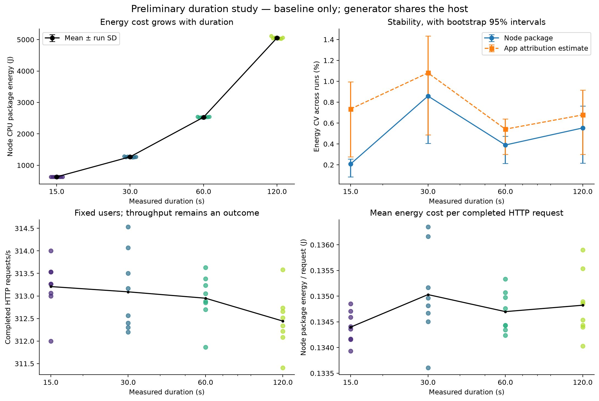
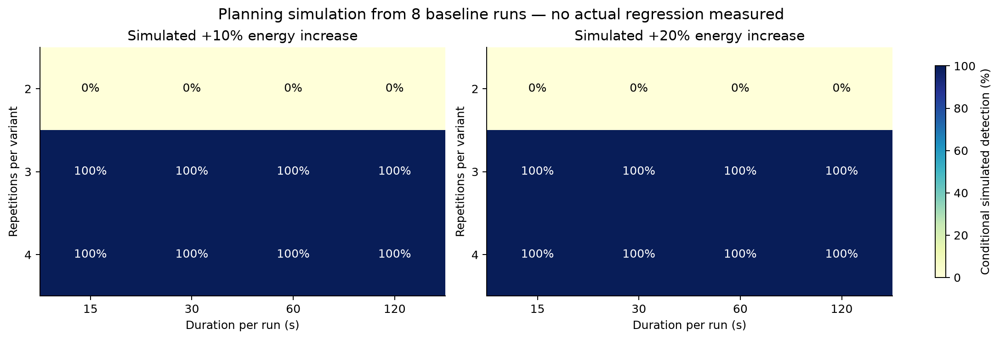
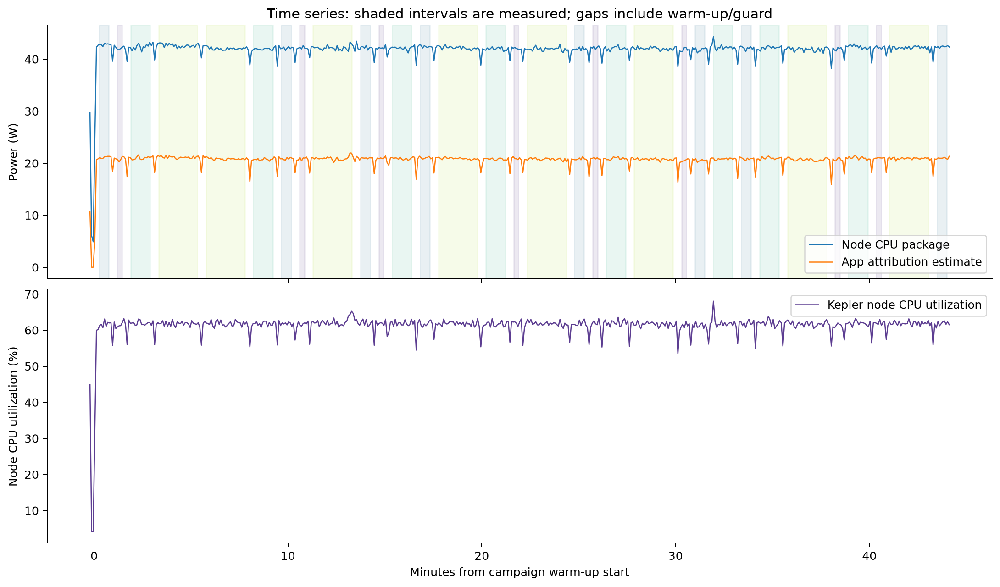
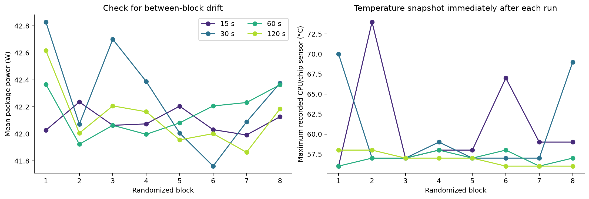

# Preliminary energy benchmark results

## Main finding

Completed **32 baseline runs**: eight repetitions at each of 15, 30, 60 and 120 seconds, after smoke testing. There were **562,888 measured HTTP requests and 0 failures**. All runs used 3 concurrent users, no think-time pauses, the same shopping scenario and per-user seed. **These results do not establish a shortest reliable regression-detection duration.** No actual regression variant was run, and eight baseline repetitions per duration cannot validate both 80% detection and a 5% false-alarm ceiling.

The lowest observed node-energy CV was **0.21% at 15 seconds**. CV decreased monotonically with duration: **False**. The 120-second runs consumed **8.01×** the mean measured package energy of 15-second runs. Bootstrap intervals and temporal drift checks below must be considered before treating an apparent CV improvement as stable. The application pod-attribution estimate had its lowest CV at **60 seconds (0.54%)**, rather than the node metric's minimum. Attribution is not an independent hardware measurement; choosing a duration from node CV alone would be premature.

Campaign measurement span: 2026-11-19T00:28:09.277097+00:00 to 2026-11-19T01:12:08.718419+00:00 (UTC; add one hour for Berlin). Measured windows total 30.0 minutes. Wall span including intervening warm-up/guard: 44.0 minutes. Summed CPU-package energy inside measured windows: 75.87 kJ; this excludes setup, warm-up, the excluded guard and report generation.

## Results by duration

| Duration (s) | Runs | Mean package J | SD J | CV % | Req/s | J/HTTP request | Mean p95 latency ms |
| --- | --- | --- | --- | --- | --- | --- | --- |
| 15 | 8 | 631.4 | 1.3 | 0.21 | 313.2 | 0.1344 | 12.4 |
| 30 | 8 | 1268.3 | 10.9 | 0.86 | 313.1 | 0.1350 | 12.4 |
| 60 | 8 | 2529.3 | 9.9 | 0.39 | 313.0 | 0.1347 | 12.4 |
| 120 | 8 | 5055.0 | 28.0 | 0.55 | 312.4 | 0.1348 | 12.4 |

`results/stability_comparisons.csv` quantifies relative CV changes between consecutive duration doublings, with paired-block bootstrap intervals. Small observed changes do not prove a plateau. `results/duration_summary.csv` also contains bootstrap CV confidence intervals, application attribution estimates, energy sample counts, interval energy/request percentiles and temporal power variation. Across-repetition SD is in joules. The CSV field `temporal_normalized_5s_energy_sd_j` separately gives within-run SD of native, fully enclosed energy intervals after normalizing their power × 5 seconds to a common five-second energy increment. Partial boundary intervals are excluded; this is not SD of a rising cumulative counter. Short runs provide very few such intervals. Within-run temporal variation is the SD of the reconstructed power curve in watts, evaluated on a common one-second grid; that grid does not create extra independent measurements. The CSV also reports SD of Kepler's power-gauge samples. Differences between counter-derived and gauge-based variation can reflect unsynchronized exporter/scrape timing and repeated counter snapshots, rather than real power excursions.

## Smoke tests and quality gates

| Users | Req/s | Failures | p95 latency ms | Peak CPU fraction |
| --- | --- | --- | --- | --- |
| 1 | 144.5 | 0 | 9.0 | 0.269 |
| 3 | 316.2 | 0 | 12.2 | 0.635 |
| 5 | 376.3 | 0 | 17.9 | 0.755 |

Selected 3 users using a pre-campaign rule: zero failures, observed peak node CPU ≤75%, p95 HTTP latency <100 ms. The 5-user stage is excluded if it exceeds the CPU headroom rule, even with no errors. Smoke runs are excluded from the duration analysis. All campaign runs must have ≤0.1% request failures, positive node/app energy, no counter resets, complete raw samples bracketing both cutoffs, no scrape gap >10.5 seconds, and measurement timer drift <0.5 seconds. The actual campaign failure count was 0. Health and target checks are recorded separately.

## Calibration and cutoff correction

The initial revision stopped load exactly at the cutoff. With five-second energy samples, interpolation across the resulting load-to-idle step can bias short windows. Collection was stopped when this design issue was identified; all revision-1 data are retained in `calibration_v1/` and excluded from the main analysis before the revised campaign. Revision 2 keeps the same loaded guard beyond every cutoff and was re-smoke-tested before the final campaign. No runs were excluded based on their energy/CV results.

## What was changed in the cloned project

The original repo at `/root/sustainable_computing`, revision `1d9ef66`, contained only `pipeline.py`; it did not contain the referenced Locust file. Its metric `kepler_container_joules_total` does not exist in this Kepler version, and its `monitoring` namespace would select the monitoring stack instead of the application. It also redeployed the application, warmed up without load and included Locust startup in the interval.

An isolated Git working copy on `codex/preliminary-energy-study` adds a seeded Locust workload, a guarded local experiment controller and this analysis. It operates against the existing deployment and does not deploy a new application version, introduce an artificial CPU regression, or create a CI/CD pipeline. Original code is preserved in `research/original_pipeline.py`.

## Workload and experiment protocol

Each user continuously repeats home → product → add-to-cart → cart → mock checkout. Product selection uses a separate PRNG seeded by `20261119 + user_id` in every run. HTTP status and response content are checked. There are no think-time sleeps. Every run has a 15-second loaded warm-up after all users spawn, an exact measurement window and an 11-second loaded post-cutoff guard. The load remains active through the guard so boundary interpolation does not mix a post-test transition to idle into the measured interval. Only request completions inside the measurement window enter the reported totals; raw Locust console totals include the guard and are diagnostic rather than the authoritative measured totals. Authoritative per-operation data are in `measured_stats.csv`; asynchronous built-in Locust CSV output is disabled after a shutdown writer race was observed during smoke testing. Eight randomized complete blocks each contain one run of every duration; `results/campaign_plan.json` records the order.

Fixed users define a **closed-loop concurrency workload**, not a constant arrival rate. Throughput is an outcome, and the same seed reproduces each user's product-selection prefix rather than a bit-identical global request schedule. Response-dependent task completion and concurrent scheduling change the total number/interleaving of requests. A complete journey contains five instrumented Locust HTTP operations. Redirect chains are counted as one operation by Locust, so the denominator is not a server-side wire-request count. Static browser assets are not fetched.

## Energy measurement and the requested p95 metric

Primary energy is the change in Kepler's **node CPU-package active + idle accumulated energy counters**, in joules. Secondary energy is the sum of `kepler_pod_cpu_joules_total{pod_namespace="online-boutique",zone="package",state="running"}` deltas for all 11 pods. The primary sum reconstructs package energy; its active/idle split and all per-pod allocations are estimates. RAPL is hardware-reported package energy, not whole-server wall-socket energy. Package and core zones are not added together; DRAM power is retained separately.

Prometheus raw range-vector samples are saved for every run. Boundaries use linear interpolation between adjacent raw scrape samples, with the same [start,end) window used for completed-request counts. No missing metric is silently treated as zero, and no Prometheus `increase()` extrapolation is used. The native sampling interval is about five seconds: the 15-second windows contain only about three samples. Boundary interpolation smooths short windows and can influence their apparent CV. This resolution limits how finely a minimum duration can be studied.

**True p95 energy per individual request is unavailable from these aggregate counters.** The CSV field `p95_interval_j_per_request` is explicitly a proxy: for each approximately five-second energy interval, divide package joules by the number of HTTP requests completed in that interval, then take the 95th percentile of those ratios. Partial intervals shorter than four seconds are excluded. This is neither p95 request latency nor p95 independently measured request energy. `node_j_per_request` is the run mean J/completed HTTP request. Temporal overlap and co-located work remain included.

## A/A checks and regression-detection planning

The actual experiment contains only the unchanged baseline. Predefined pseudo labels by randomized block are A,B,B,A,A,B,B,A. For n=4, the exact one-sided permutation tests below compare four A-labelled runs with four B-labelled runs at each duration. They test for an increase in mean package energy:

| Duration (s) | A/A p-value | Pseudo B vs A % |
| --- | --- | --- |
| 15 | 0.6857 | -0.07 |
| 30 | 0.8000 | -0.58 |
| 60 | 0.8000 | -0.23 |
| 120 | 0.8714 | -0.50 |

There were 0 rejections among these four duration-specific A/A checks. These are few checks under shared host conditions, and smaller-n tests reuse data. They do **not** demonstrate a long-run false-alarm rate ≤5%. Even zero false alarms would require at least 59 independent A/A comparisons for a one-sided 95% binomial upper bound below 5%, assuming independent identically distributed trials.

For planning only, we exhaustively choose disjoint A/B subsets from each duration's eight baseline runs and multiply B energies by a known 5%, 10%, 20% or 30%. The test is an exact one-sided permutation test at α=0.05. Effect sizes refer to node CPU-package energy increases, not code slowdown or isolated application energy increases; background and generator energy affect that relationship. The following rates are conditional simulated sensitivity under multiplicative energy shifts with unchanged sampled noise, not measurements of actual code regressions. The CSV also includes nominal comparison time (2 × n runs including warm-up/guard/startup) and estimated measured-window energy cost. It excludes unmeasured warm-up/guard energy and all CI/CD deployment overhead:

| Duration (s) | n per variant | Simulated increase % | Conditional detection % |
| --- | --- | --- | --- |
| 15 | 3 | 10 | 100.0 |
| 15 | 3 | 20 | 100.0 |
| 15 | 4 | 10 | 100.0 |
| 15 | 4 | 20 | 100.0 |
| 30 | 3 | 10 | 100.0 |
| 30 | 3 | 20 | 100.0 |
| 30 | 4 | 10 | 100.0 |
| 30 | 4 | 20 | 100.0 |
| 60 | 3 | 10 | 100.0 |
| 60 | 3 | 20 | 100.0 |
| 60 | 4 | 10 | 100.0 |
| 60 | 4 | 20 | 100.0 |
| 120 | 3 | 10 | 100.0 |
| 120 | 3 | 20 | 100.0 |
| 120 | 4 | 10 | 100.0 |
| 120 | 4 | 20 | 100.0 |

With n=2 per variant, the smallest attainable exact p-value is 1/6, so this test cannot reject at 5%. With n=3 it is 1/20=0.05, and with n=4 it is 1/70. Reusing the same eight baseline observations makes simulated percentages optimistic or unstable as general forecasts. Enumerated A/A rejection rates reflect the permutation test's conditional calibration; they are not independent validation of the real deployment's false-alarm rate. In particular, no duration is certified as meeting the RQ's reliability target.

## Drift and environmental limitations

Spearman correlation between run order and mean package power was -0.141 (exploratory p=0.4422; no causal interpretation). Randomized blocks reduce systematic order effects but do not remove temporal autocorrelation or background activity.

- **Load generator and SUT share the same physical host/kernel.** The node metric includes Locust, Kubernetes, Prometheus, Grafana, SSH and other host work. Application attribution is useful context, not a clean subtraction or independent hardware measurement. Generator CPU time is recorded as a diagnostic; it includes startup, warm-up and report writing.
- Security updates completed before the study. The running kernel was held unchanged; a newer installed kernel awaits a separate planned reboot. Daily maintenance timers were inspected and did not overlap the planned campaign. No firewall, SSH, exporter, scrape interval, resource requests, service replica count or CPU-governor changes were made for these tests.
- Kepler retains existing process exports and debug logging. Monitoring overhead and the effect of UI queries are not isolated. This is a single machine, single application revision, single workload level and one session.
- A fixed closed-loop user count does not guarantee identical completed work. A slower future variant may complete fewer operations within the same duration; assess total energy together with throughput, failures and J/operation.
- Multiple duration/effect/n comparisons are exploratory; selecting a favorable candidate on these data requires independent confirmation, with appropriate control of the final decision rule.
- Eight observations per duration give imprecise CV confidence intervals and weak independent evidence about detection/false alarms. The CV plateau screen (less than 10% relative improvement per duration doubling) is exploratory and does not establish a stable asymptote.
- The application was not redeployed or restarted between repetitions. These runs characterize an already-warm, long-lived deployment; they do not include fresh-deployment, container-startup or cold-cache variance.
- This pilot is not a CI/CD-overhead experiment. Per-run wall time is saved, but reporting and environment setup energy are excluded from measured benchmark energy. A later experiment must measure end-to-end pipeline cost separately.

## Practical next experiment

The planned +5% to +30% models saturate at 100% conditional detection for n≥3 at every duration in this small sample. They therefore do not discriminate duration choices here. Smaller effects and independent actual-regression tests are needed; a minimum duration is always conditional on a defined effect size.

Use an external load generator, freeze and record the environment after any planned reboot, and keep the same workload/cutoff rule. Collect a fresh randomized/block-balanced baseline, then run actual controlled regression variants at explicitly defined effect sizes. Predefine the comparison test, α, practical effect size and n. Validate detection and false alarms on **independent** A/B and A/A comparison batches, not resampling of the selection data. Use the present CV and conditional power plots to choose a smaller candidate grid; retain a longer reference duration to check whether the apparent stability improvement persists.

For an illustrative precision target, 59 independent A/A comparisons with zero false alarms are needed for a one-sided 95% upper confidence bound below 5%; hundreds may be needed to estimate detection rates near the 80% boundary precisely. Duration and repetition count must be chosen together and assessed against benchmark energy plus pipeline overhead.

## Files and rerunning

- `results/runs.csv`: one row per measured run, with workload, energy, latency, timing and quality fields.
- `results/duration_summary.csv`: means, SD, CV and bootstrap intervals by duration.
- `results/stability_comparisons.csv`: paired-block bootstrap comparisons of CV improvement.
- `results/conditional_detection.csv`: conditional resampling estimates for effect size × duration × n.
- `results/aa_comparisons.csv`: predefined actual baseline-versus-baseline comparisons.
- `results/power_timeline.csv`: raw scrape-derived power/CPU timeline.
- `results/block*/`: raw Prometheus samples, per-request completions, interval energy CSV, measured operation CSV, Locust console output and run metadata.
- `research/protocol.json`: analysis and experiment design recorded before the campaign.
- `figures/`: PNG/SVG figures and `report.pdf` containing summary and charts.

Install the pinned dependencies in a Python environment, then use `python pipeline.py --mode smoke`, followed by `python pipeline.py --mode campaign --users 3 --repetitions 8`, and `python pipeline.py --mode analyze`. The controller refuses to overwrite existing run directories; archive/move the existing `results/` before a fresh campaign. Host and Prometheus URLs can be overridden. No application deployment is performed by this entry point.

Sources: [Locust workload behavior](https://docs.locust.io/en/stable/writing-a-locustfile.html), [Kepler energy attribution](https://sustainable-computing.io/kepler/usage/power-attribution/), [Prometheus query functions](https://prometheus.io/docs/prometheus/latest/querying/functions/). Most reported facts are direct observations from the saved raw data.
