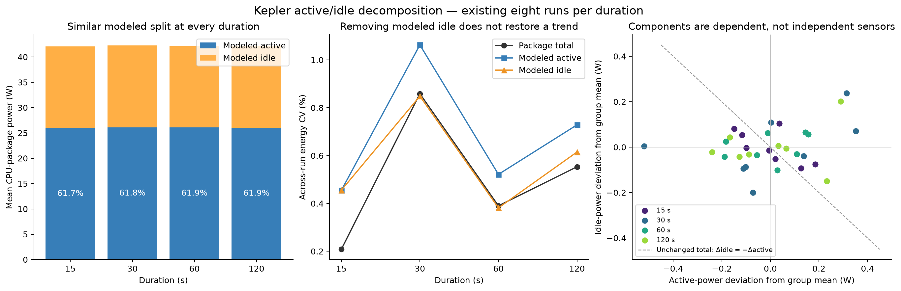

# Active/idle decomposition of the existing pilot

## Purpose and method

No new load was generated. For all 32 original runs, the saved raw Prometheus samples of `kepler_node_cpu_active_joules_total{zone="package"}` and `kepler_node_cpu_idle_joules_total{zone="package"}` were interpolated at exactly the same cutoffs as the original report. Each pair of deltas was checked to reconstruct the reported node package total to within 0.000001 J.

## What the labels mean

Kepler uses CPU utilization to model an active/idle split of hardware-reported package energy. Per sampling interval the conceptual model is:

- active energy = package energy × CPU utilization ratio
- idle energy = package energy − active energy

The split is not two independent hardware measurements. “Idle” during load is not the energy separately measured with the server unloaded, and it is not all energy unrelated to Online Boutique. “Active” is node-wide activity and includes Locust, monitoring and other host processes. Pod attribution applies another CPU-time allocation to active energy.

Source: [Kepler power-attribution documentation](https://sustainable-computing.io/kepler/usage/power-attribution/). The guide's CPU example explicitly splits 40 W at 25% utilization into 10 W active and 30 W idle. This is a utilization-based model, not an empirical unloaded-baseline measurement.

## Observed results

| Duration | Mean active J | Mean idle J | Active CV | Idle CV | Total CV | Correlation active/idle |
|---|---:|---:|---:|---:|---:|---:|
| 15 s | 389.8 | 241.6 | 0.45% | 0.46% | 0.21% | -0.67 |
| 30 s | 783.7 | 484.6 | 1.06% | 0.85% | 0.86% | +0.47 |
| 60 s | 1565.2 | 964.0 | 0.52% | 0.38% | 0.39% | +0.29 |
| 120 s | 3127.0 | 1928.0 | 0.73% | 0.61% | 0.55% | +0.23 |

Mean active share stays around 61.7–61.9%, consistent with the observed utilization near 62%. Mean modeled idle power is roughly 16.1 W at every duration, while active power is roughly 26.0–26.1 W. Therefore there is no obvious duration-dependent shift in the average active/idle proportion explaining the CV ranking.

Both component CVs are non-monotonic with duration. Merely switching the primary metric from total to modeled active energy does not restore a consistent “longer is more stable” result.

## Why correlation matters

For the energy deltas across repetitions:

`Var(total) = Var(active) + Var(idle) + 2 × Cov(active,idle)`.

At 15 seconds the active/idle correlation is −0.67. Their sample variances are about 3.14 J² and 1.21 J², while twice their covariance is −2.62 J². The resulting total variance is only 1.73 J², giving total SD 1.31 J. Thus the total has lower relative variability than either modeled component. Utilization changes can move estimated energy between the components while total package energy changes little. This observation does not make the physical total artificially wrong; it shows why these component estimates cannot be interpreted as independent measurements.

At 30 seconds correlation is +0.47: both components more often move in the same direction. The 30-second spread is therefore not solely an active-to-idle allocation swap. At 120 seconds the first block has both high active energy and high idle energy, consistent with its higher package total. These are descriptive patterns from eight runs each, not causal diagnoses.

## What this explains and what remains open

This decomposition helps explain the unusually tight total relative to its modeled components at 15 seconds. It also shows that the wider 30-second totals are not exclusively due to idle-attribution variability. It does not identify why the underlying package totals differed. Frequency/power-state changes, instruction mix, thermal conditions, background work and measurement timing remain possible contributors and were not independently isolated.

The plots compare separate run totals, not variation within one time trace. A fixed whole-run power offset is not necessarily averaged away by increasing duration, unlike some short-lived fluctuations. This is a possible mechanism for non-monotonic CV, not a demonstrated cause in this dataset.

## Recommended follow-up

Retain the split as a diagnostic, keep the physical package-total outcome alongside performance/work-count metrics, and choose the primary metric before testing variants. Measure actual no-load baseline windows separately, preferably before and after randomized blocks. Move Locust to another host and record frequency, temperatures, process activity and delivered work. Use actual controlled regression variants and fresh A/A comparisons for detection validation. Subtracting Kepler's modeled idle term alone is not a clean isolation of application energy or a validated noise correction.

All earlier limitations remain: eight repetitions per duration, one session, five-second energy sampling, co-located generator and already-warm deployment. These analyses reuse the same data and do not add independent evidence.
