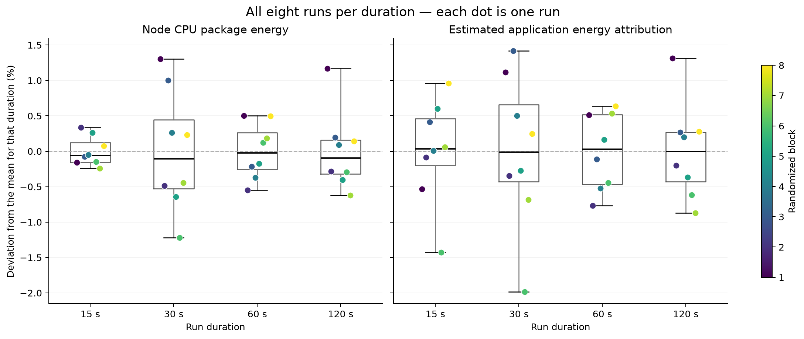
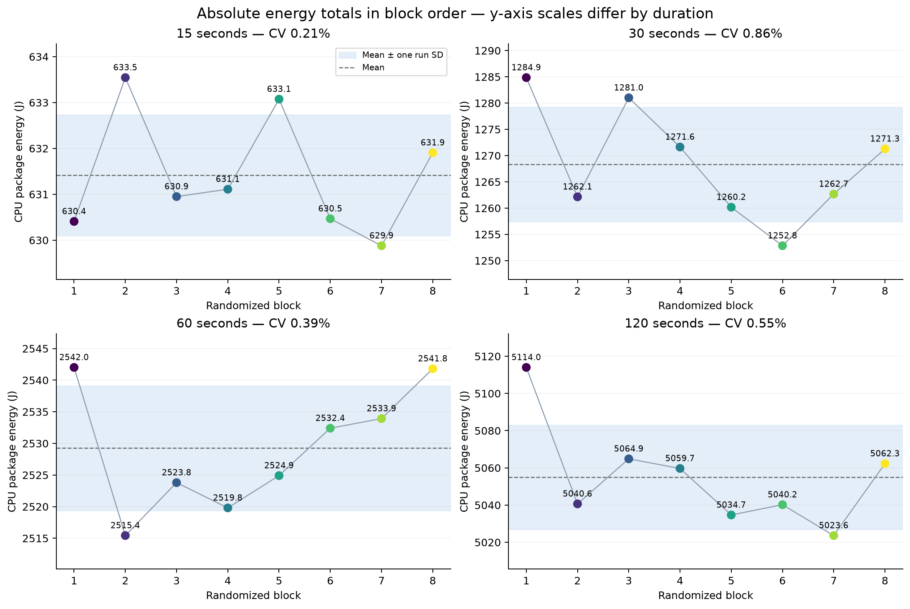

# Distribution follow-up: existing pilot data

## What “define the regression size” means

A minimum duration is conditional on the smallest energy increase worth detecting. This pilot's observed across-run variation was low compared with the simulated +5% to +30% shifts. The modeled signal was large relative to the noise, so most planned simulation cases were easy. That is why they reached 100% conditional detection and did not distinguish durations. This does not establish 100% detection in new experiments or actual code regressions.

For 15-second runs, mean node energy was 631.4 J and run-to-run sample SD was 1.31 J. A +5% energy shift is about 31.6 J, or 24 single-run SDs. For 30-second runs, mean energy was 1268.3 J and SD 10.89 J; +5% is 63.4 J, about 5.8 SDs. These SD multiples describe scale; they are not detection probabilities. A +1% shift at 30 seconds is only 12.7 J, about 1.16 SDs, and would be a more challenging planning case.

## Distributions across repeated runs

| Duration | Mean J | Median J | SD J | Min–max J | CV |
|---|---:|---:|---:|---|---:|
| 15 s | 631.4 | 631.0 | 1.31 | 629.9–633.5 | 0.21% |
| 30 s | 1268.3 | 1267.0 | 10.89 | 1252.8–1284.9 | 0.86% |
| 60 s | 2529.3 | 2528.7 | 9.87 | 2515.4–2542.0 | 0.39% |
| 120 s | 5055.0 | 5050.2 | 27.97 | 5023.6–5114.0 | 0.55% |

Every dot is a measured run. Each distribution is centered on its own duration mean so that spread can be compared without longer durations' larger total energy dominating the scale. Boxes show quartiles; whiskers span the observed min/max, not an outlier rejection rule. Color shows randomized block. The two panels show different metrics from the same 32 runs, not 64 independent experiments. Pod energy is an attribution estimate.

- **15 seconds:** all eight node-energy totals lie in a 3.66 J band, only 0.58% of their mean. Removing any one observation changes CV to 0.17–0.22%; its tight spread is not created by a single central point. It still has only three raw energy samples inside each measurement window, so its apparent stability needs independent validation.
- **30 seconds:** the widest relative spread, 1252.8–1284.9 J, or 2.52% of the mean. Blocks 1 and 3 were high; block 6 was low. Removing any one run leaves CV around 0.73–0.92%. Its wider spread is not explained by one observation alone.
- **60 seconds:** 2515.4–2542.0 J, a 1.05% observed range relative to the mean; intermediate variability.
- **120 seconds:** 5023.6–5114.0 J, or 1.79% of the mean. Block 1 was the highest value. Omitting it would reduce CV from 0.55% to about 0.31%, demonstrating sensitivity to one run. It remains included: there is no independent reason to discard it.

“Noise” here means variability across separate run totals at the same duration. It is different from variation within a single run. The existing master CSV also records within-run power SD and native-interval energy variation. A trace can fluctuate within each run yet integrate to similar totals across repetitions.

## Every run total

| Block | 15 s (J) | 30 s (J) | 60 s (J) | 120 s (J) |
|---|---:|---:|---:|---:|
| 1 | 630.4 | 1284.9 | 2542.0 | 5114.0 |
| 2 | 633.5 | 1262.1 | 2515.4 | 5040.6 |
| 3 | 630.9 | 1281.0 | 2523.8 | 5064.9 |
| 4 | 631.1 | 1271.6 | 2519.8 | 5059.7 |
| 5 | 633.1 | 1260.2 | 2524.9 | 5034.7 |
| 6 | 630.5 | 1252.8 | 2532.4 | 5040.2 |
| 7 | 629.9 | 1262.7 | 2533.9 | 5023.6 |
| 8 | 631.9 | 1271.3 | 2541.8 | 5062.3 |

The first block was high at 30, 60 and 120 seconds, but was not consistently high at 15 seconds. This warrants examining time/order and background activity; it does not identify a cause or justify dropping early runs. Warm-up, temperature, background work, exporter timing and ordinary sampling variation remain possible explanations. The application-attribution metric also has a different CV ranking: 60 seconds is lowest (0.54%), versus 0.74% at 15 seconds.

## What the sample can and cannot show

There are eight observations per duration. That is enough to display the data, describe its range and assess sensitivity to individual points, but not to establish Gaussian shape, tail behavior, bimodality, a stable CV plateau, or a universal minimum duration. For that reason the plots show all points rather than fitted normal curves or smoothed violin densities. CV confidence intervals from the original analysis remain approximate.

The generator was co-located with the SUT, the application stayed warm, and the primary metric covers the CPU package rather than the whole server. These limitations carry over unchanged. This follow-up launches no new load and does not modify or exclude any observations.

Files: `distribution_summary.csv` contains quartiles, ranges, SD and leave-one-out sensitivity; `all_runs.csv` contains both metrics and centered deviations; `all_run_energies_by_block.csv` is the full 8×4 energy table; `distribution_figures.pdf` contains both figures.
