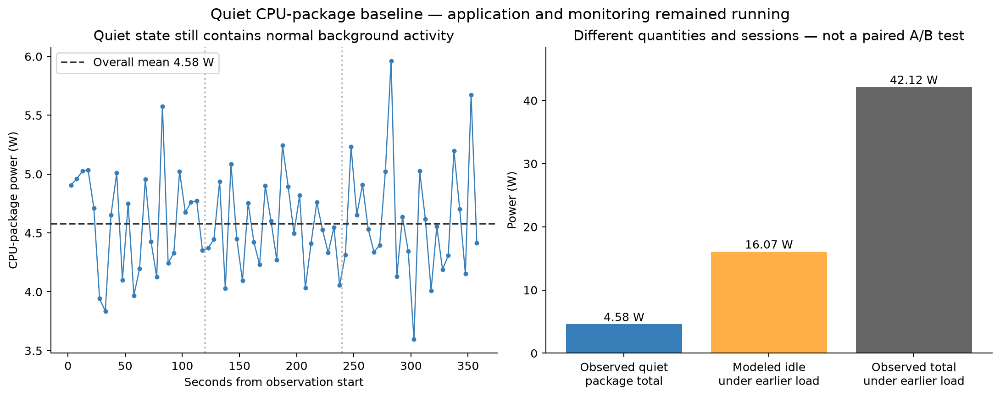

# Quiet CPU-package baseline — 19 November 2026

Observation: **10:49:48–10:55:48 Europe/Berlin**, after 60 seconds of settling. Three consecutive 120-second windows; six measured minutes in total. No load generator was started. Online Boutique, Redis, Kubernetes, Kepler, Prometheus and Grafana stayed deployed and running.

## Results

| Window | Duration | Package energy | Mean package power | Mean CPU utilization | Non-health frontend requests |
|---|---:|---:|---:|---:|---:|
| 1 | 120 s | 550.4 J | 4.587 W | 4.94% | 0 |
| 2 | 120 s | 543.5 J | 4.529 W | 4.78% | 0 |
| 3 | 120 s | 554.7 J | 4.622 W | 4.86% | 0 |

Mean CPU-package power: **4.579 W**. Total measured package energy: **1648.6 J over 360 seconds**. SD of the three window-average powers: 0.047 W; descriptive CV: 1.03%. These adjacent windows are not independent experimental repetitions, and no population stability claim or confidence bound is inferred from them.

Across the native approximately five-second power-gauge samples, values ranged from 3.60 to 5.96 W. Quiet means no intentional shopping workload, not zero activity. Average Kepler CPU utilization remained approximately 4.86%, with normal control-plane, monitoring, app background work and health probes.

## Traffic and health verification

No local Locust process was found at precheck, after settling or during repeated process checks. The frontend recorded 72 health-probe requests and zero completed non-health requests inside the measured interval. Pod identities and restart counts were unchanged, every pod was Ready at both checks, and all Prometheus targets were healthy afterward. Kernel/boot and CPU-governor checks matched the earlier campaign.

Energy came from the same package-only active + idle accumulated Kepler counters as the earlier study. Raw scrape samples bracket every cutoff; missing samples, excessive gaps and resets are rejected. Counter deltas over adjacent windows reconstruct the full observation delta. No sum of overlapping package/core zones is used. This is CPU-package energy, not whole-server wall power.

## Measured quiet baseline versus modeled idle

The quiet package total averaged **4.58 W**. Under these quiet conditions, Kepler partitioned it into approximately **0.22 W modeled active** and **4.36 W modeled idle**. The earlier loaded 120-second cohort averaged **42.12 W package total**, of which approximately **16.07 W was labeled modeled idle**.

This illustrates the distinction: Kepler's loaded idle term is a utilization-based partition of loaded package energy, not a separately measured unloaded power baseline. The two values need not agree.

An illustrative difference between earlier loaded power and this quiet reference is 37.55 W. **That is not isolated application power**: the loaded study included co-located Locust, changed host activity and different CPU operating states. It was also measured hours earlier, so this is not a controlled paired before/after comparison. The quiet reference must not silently be subtracted from old runs to claim validated application energy or revised detection rates.

The earlier loaded 120-second runs had a package-energy SD of 27.97 J and CV of 0.55%, whereas these quiet windows had an energy SD of 5.64 J and CV of 1.03%. A larger relative CV can coexist with smaller absolute variation because the quiet-state mean is much smaller. Sample sizes and observation periods differ, so this is descriptive rather than a variance comparison test.

## Limitations and next use

This observation was taken in the morning, hours after the loaded session; system maintenance may have run between sessions. Kernel, governor configuration and app pod identities were consistent, but that does not establish identical thermal or background conditions. Temperature snapshots were taken before the settling period and after observation; continuous thermal stability was not established. No services or security controls were stopped to force an artificial idle state.

For a controlled follow-up, take quiet windows immediately before and after randomized load blocks, keep the generator external, and record CPU frequency, temperatures and background activity. A predeclared baseline subtraction can estimate incremental package energy above quiet operation, with baseline uncertainty retained; it cannot by itself assign that energy exclusively to the application.

## Files

- `windows.csv`: measured window totals, power, CPU utilization and traffic counts.
- `power_samples.csv`: native quiet power-gauge samples.
- `comparison.csv`: explicitly labeled quiet/loaded and modeled/measured quantities.
- `raw_prometheus.json`: raw counter/power/utilization samples.
- `measurement.json`, environment/configuration and pod/target snapshots: timing and verification evidence.
- `measure_quiet.py`, `analyze_quiet.py`: measurement and reporting code. The measurement script refuses to overwrite an existing result and never launches Locust.
